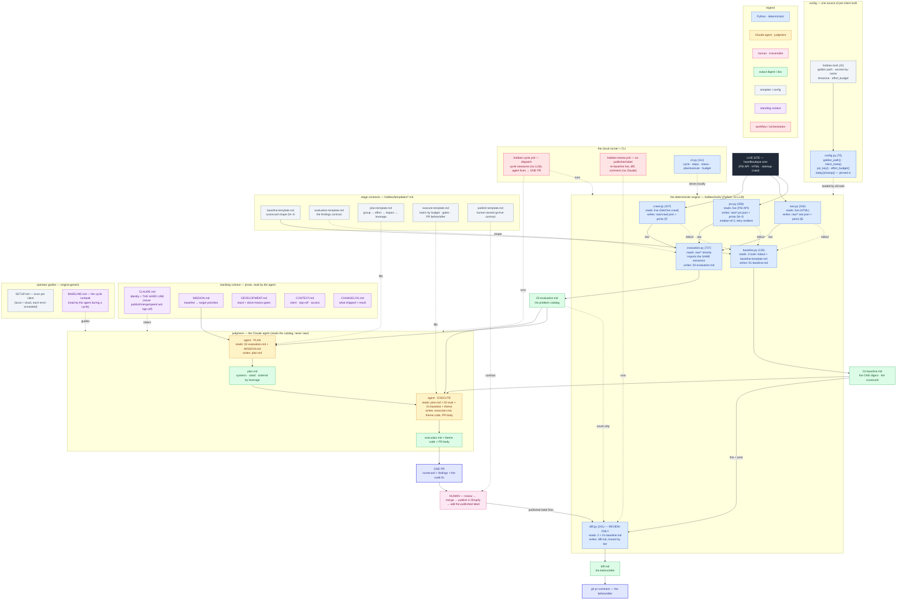

This mermaid chart demonstrates my understanding of how Hobbes currently cooperates with humans:

Int he future I'd imagine hobbes works as an MCP or CLI tool that you have your agent operate.

Hobbes has several sections. The first is the configuration system which serves as the single source of truth for the client. `hobbes.toml` is per-client configuration including client info, the golden path web addresses,
