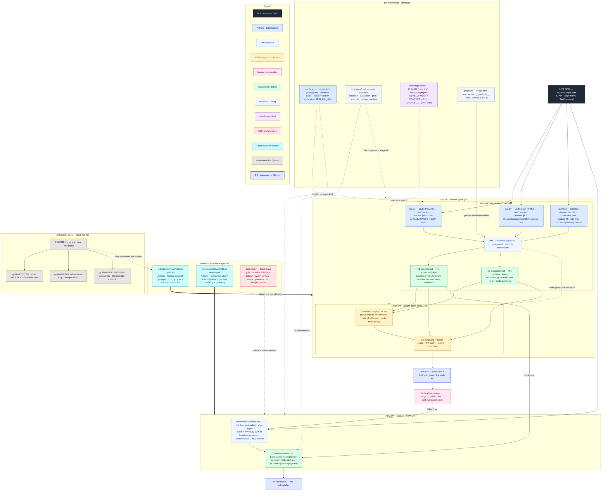

# Hobbes — system map

Hobbes is a **web-baseline + agentic-fix system**: it measures a live site, catalogs what's wrong, plans the highest-leverage fixes, writes them as a pull request, and — once a human publishes — re-measures to prove the impact. It runs in GitHub Actions on a Claude Code subscription, and it **writes only to GitHub** (branches, PRs, comments). Every deploy action — preview, publish, go-live — stays human.

This file is the map of the whole system. For *setup*, see [`guides/SETUP.md`](SETUP.md). For *what Hobbes is and how it behaves*, see [`../CLAUDE.md`](../../CLAUDE.md).

---

## The pipeline

Six stages, split across a hard **determinism boundary**: deterministic tools do the measuring and comparing; a Claude agent does the judgment (plan + fix); a human owns going live.

```
   ON-DEMAND — one trigger fires measure + fix together, into ONE PR
   (Actions → "Hobbes cycle"; or `python3 hobbes/tools/cli.py cycle` locally for the data alone)
   ┌────────────────────────────────────────────────────────────────┐
   │  DETERMINISTIC (Python, no LLM)   │   JUDGMENT (Claude agent)    │
   │  baseline ─► findings             │   plan ─► execute            │
   └────────────────────────────────────────────────────────────────┘
                       │ ONE PR: scorecard + findings + the code fix
                       ▼ you review + merge
   HUMAN
   ┌─────────────────────────────────────────────┐
   │  publish (go-live)  +  `published`           │   ← you, on your platform, then a PR label
   └─────────────────────────────────────────────┘
                       │ label fires
                       ▼
   DETERMINISTIC
   ┌──────────────────────────────────────────────────────────────┐
   │  review = publish-review (live → raw-review/) ──► review.py   │   ← review workflow (on the label)
   │           diff vs pre-publish 01-baseline ──► PR comment      │
   └──────────────────────────────────────────────────────────────┘
```

| Stage | Kind | Produces | Runs in |
|---|---|---|---|
| **baseline** | tool | `01-baseline.md` (+ raw/) — the scorecard | cycle workflow |
| **findings** | tool | `02-evaluation.md` — the problem catalog | cycle workflow |
| **plan** | agent | `plan.md` — systems grouped, rated, ordered by leverage | cycle workflow |
| **execute** | agent | `execution.md` + code changes | cycle workflow |
| **publish** | human | the change live on the site | you, on your platform |
| **review** | tools (`publish-review.py` → `review.py`) | a **before/after comment** on the PR | review workflow (on `published`) |

> The first four stages (baseline, findings, plan, execute) run in **one** `Hobbes cycle` workflow and land in **one PR** — the scorecard/findings (data) beside the code fix. The determinism boundary still holds inside that run: the Python tools measure first (reproducibly, no LLM), then the agent judges and fixes. **There is no diff in a cycle** — a cycle measures the current site and has no "after" to compare (this cycle's fix isn't live yet). The before/after is the **review** stage's job, after a publish.

**Why the boundary matters:** measurement must be reproducible (same raw → same findings, IDs and all), so it's deterministic and rebuilt every cycle. Fixing is judgment (what to group, what it costs, what it's worth, what the root cause is), so it's the agent's. Going live is irreversible and outward-facing, so it's the human's.

---

## Follow the data — what reads what, and who emits the content

The stage table above says *what each stage produces*. This is the other axis — the one that's easy to lose: **what each file reads, what it writes, and who consumes that next.** Follow one cycle's data from the live site all the way to the PR comment — and around the dataflow, the **drivers** that fire each phase (the two workflows + the CLI), the per-client **config and contracts** that feed the stages, and the **orientation docs**, so **every file in the repo appears on this map.**



**Five handoffs worth understanding — this is the "what each file does along the way":**

1. **Two readers, one source — no middle file.** Each capture tool writes its raw JSON to `raw/` (and, run standalone, also prints a human-readable digest to stdout). `baseline.py` **imports the three tools and renders §A–F straight from `raw/`** — calling each tool's own `scorecard_section(s)()` — then stamps them into `01-baseline.md` with §G from `baseline-template.md`. No stdout is scraped and no per-tool `*-results.md` lands on disk. `evaluation.py` reads the **same** `raw/` artifacts (`raw/*.psi.json`, `raw/crawl.json`) directly for its node-level detail. `raw/` is git-ignored. This is why `02-evaluation.md` can't be rebuilt from `01-baseline.md`: the catalog needs node-level evidence the scorecard's summary tables threw away.
2. **The catalog and the scorecard share their renderers, and both rebuild from `raw/`.** `baseline.py` renders each scorecard section by calling the *same function* the standalone tool uses (`psi.scorecard_sections`, `seo.scorecard_section`, `crawl.scorecard_section`), so the digest and a standalone tool run can't disagree — and the scorecard re-renders from cache with no re-fetch. `evaluation.py` then *imports* the extractors it needs — `Page` / `head_ok` / `OG_REQUIRED` from `seo.py`, `table_rows` / `count_for` / `rollup_texts` / `header_set` from `crawl.py`, and the `a11y_audit_failed` predicate from `psi.py` — so where a number depends on "what counts" (a failing axe audit, a missing OG tag, a flagged crawl row), the catalog and the scorecard ride the *same definition*. The two are still **separate scripts** — the scorecard renders compact section tables, the catalog re-walks the PSI JSON for per-node evidence the scorecard never keeps — but neither scrapes the other's output, and both read only `raw/`.
3. **The review runs only post-publish — never in a cycle.** A cycle measures the current site; it has no "after" to compare (this cycle's fix isn't even live yet). So the before/after lives entirely in the post-publish **review**, split across two review-only tools, both writing inside the PR's own cycle folder: `publish-review.py` (a twin of `baseline.py`) re-captures the **live** site into `raw-review/` and renders the after-digest `raw-review/baseline.md`; `review.py` then diffs the cycle's pre-publish `01-baseline.md` (the before — everything leading up to the PR) against that after-digest, re-parsing both tables back into numbers and comparing them tier by tier (field / lab / axe / counts) through `review-template.md`. No findings re-run — the review needs the measured before/after, not a rebuilt catalog. (This is also where the **28-day CrUX field** impact of a fix finally shows — the review fires too soon after publish for field to move, so it's the *next* review/cycle that confirms it.)
4. **The agent's primary input is the catalog, not `raw/`.** Judgment works off `02-evaluation.md` — an already-fixed, deterministic list of problems — not the megabytes of Lighthouse JSON. `raw/` stays a **break-glass** fallback: plan or execute may drop to it when the catalog's extract isn't enough to group, cost, or author a fix — but it's the exception, never the default, because routing judgment through raw re-derives findings non-deterministically and erodes the determinism boundary. The templates (`PLAN`, `EXECUTE`) are the skeleton it must fill; the codebase is what it reads to write the actual fix.
5. **The capture tools run in both phases; the review tools don't.** psi/seo/crawl run in the cycle (driven by `baseline.py`, into `raw/`, pre-fix) **and** in the review (driven by `publish-review.py`, into `raw-review/`, on the now-live site). `publish-review.py` and `review.py` are the two pieces that are review-only — `publish-review.py` re-captures the live site into the cycle's `raw-review/`, `review.py` diffs it against the pre-publish `01-baseline.md`, and that diff (`06-review.md`) *is* the PR comment.

**The determinism boundary, restated as authorship:** every **number** and every **comparison** in this flow is emitted by Python (`baseline.py`, `evaluation.py`, `publish-review.py`, `review.py`) — reproducible, unspinnable. Only the **fix narrative and the PR prose** are the agent's, and even those ride a fixed template skeleton. The PR comment (`06-review.md`) is 100% Python; the PR body is agent prose constrained by `execute-template.md`.

### Reads → writes → consumed by

| File | Reads | Writes | Consumed by |
|---|---|---|---|
| `psi.py` | live site (PSI API) | `raw/*.psi.json` (standalone: §A–D digest) | `baseline.py` & `evaluation.py` (both read `raw/`) |
| `seo.py` | live site (HTML) | `raw/*.seo.json` (standalone: §E digest) | `baseline.py` & `evaluation.py` (both read `raw/`) |
| `crawl.py` | live site (sitemap crawl) | `raw/crawl.json` (standalone: §F digest) | `baseline.py` & `evaluation.py` (both read `raw/`) |
| `baseline.py` | `raw/` (via the tools' renderers) + `baseline-template.md` | `01-baseline.md` (the one digest) | the agent, the human, `review.py` (the before, review only) |
| `evaluation.py` | `raw/*.psi.json`, `raw/*.seo.json`, `raw/crawl.json` | `02-evaluation.md` | the agent (plan + execute) |
| `publish-review.py` | live site (psi/seo/crawl) → `raw-review/` | `raw-review/baseline.md` (the after-digest) | `review.py` (the after) — **review phase only** |
| `review.py` | `01-baseline.md` (before) + `raw-review/baseline.md` (after) + `review-template.md` | `06-review.md` | the **post-publish PR comment** — **review phase only, not a cycle** |
| agent · `PLAN` | `02-evaluation.md`, `01-baseline.md`, `MISSION.md` (impact), `DEVELOPMENT.md` + `CONTEXT.md` (effort) · `raw/` break-glass | `plan.md` | the execute stage |
| agent · `EXECUTE` | `plan.md` (primary), `02-evaluation.md`, `01-baseline.md`, `MISSION.md`, `DEVELOPMENT.md`, `CONTEXT.md`, source · `raw/` break-glass | `execution.md`, code, **PR body** | the human (review → publish) |

---

## Every file in the system

### Standing context — who Hobbes is and what it's steering by
*(Read by the agent; prose, not code.)*

| File | Role |
|---|---|
| [`../CLAUDE.md`](../../CLAUDE.md) | Hobbes's identity, stance, and **the hard line** (never publish/merge/spend without sign-off). Identical across all clients. |
| [`MISSION.md`](../MISSION.md) | What this client optimizes for, as **baseline → target** priorities (e.g. a11y, SEO, performance). Points at the scorecard for the numbers. |
| [`DEVELOPMENT.md`](../DEVELOPMENT.md) | The stack and the build rules — the "done means" gates. |
| [`CONTEXT.md`](../CONTEXT.md) | The client: goals, users, the people who sign off, where access lives. |
| [`CHANGELOG.md`](../CHANGELOG.md) | What has shipped, why, and to what result. |

### Config — the one source of per-client truth
| File | Lines | Role |
|---|---|---|
| [`hobbes.toml`](../hobbes.toml) | 29 | Per-client config: the golden path (`[[golden_path]]` label + URL entries), branch prefix, **timezone** (pins cycle dates), **effort_budget**, **sample_path** (the crawler's high-volume page type). |

### The deterministic engine — `hobbes/tools/`
| File | Lines | Role |
|---|---|---|
| [`tools/config.py`](../tools/config.py) | — | Single source loaded from `hobbes.toml`: `golden_path()`, `client_meta()`, `psi_key()` ($PSI_API_KEY), `effort_budget()`, `sample_path()`, `today()`/`stamp()` (pinned-tz dates so local + CI never disagree), and the cycle-folder helpers `new_cycle_dir()` / `latest_cycle()` / `cycle_dirs()` / `default_run_dir()` (the `<date>-<letter>` naming, one source so local + CI agree). |
| [`tools/psi.py`](../tools/psi.py) | 403 | PageSpeed Insights / Lighthouse capture → `raw/*.psi.json`; renders scorecard **§A–D** (lab perf/a11y/BP/SEO + CrUX field) from raw/ (`scorecard_sections`). Median-of-3, retry-resilient (survives PSI timeouts and truncated reads). |
| [`tools/seo.py`](../tools/seo.py) | 372 | Per-page HTML SEO checklist → `raw/*.seo.json`; renders **§E** from raw/ (`scorecard_section`) — titles, meta, canonical, OG, structured data. |
| [`tools/crawl.py`](../tools/crawl.py) | 468 | SiteOne sitemap crawl (stratified sample) → `raw/crawl.json`; renders **§F** from raw/ (`scorecard_section`) — site-wide SEO/a11y/security counts. |
| [`tools/baseline.py`](../tools/baseline.py) | 133 | Imports psi + seo + crawl: runs each `capture()` into `raw/` of one dated cycle folder (`<date>-<letter>`), then **renders §A–F from `raw/`** via the tools' own renderers into the one digest, `01-baseline.md` (stamped from `baseline-template.md`). Honors `--run-dir`. |
| [`tools/evaluation.py`](../tools/evaluation.py) | 1009 | The **problem catalog**: reads raw/ → `02-evaluation.md`, every issue with verbatim evidence + a static knowledge overlay (what it is, why it matters). Deterministic — fix/effort/impact are deliberately left to the plan. |
| [`tools/publish-review.py`](../tools/publish-review.py) | — | **REVIEW-ONLY**, a twin of `baseline.py`: drives psi/seo/crawl `capture()` of the **live** site into the cycle's `raw-review/` (beside the pre-publish `raw/`) and renders the after-digest `raw-review/baseline.md`. Honors `--run-dir`; defaults to the latest cycle. |
| [`tools/review.py`](../tools/review.py) | — | **REVIEW-ONLY** before/after (not run in a cycle), **honest by tier**: Field (CrUX, trustworthy) / Lab (§A, volatile) / **§D axe a11y** / §F counts (coverage-gated). Diffs the cycle's `01-baseline.md` (before) vs `raw-review/baseline.md` (after) through `review-template.md` → `06-review.md`. |

### The CLI
| File | Lines | Role |
|---|---|---|
| [`tools/cli.py`](../tools/cli.py) | — | `cycle` (baseline→findings), the individual steps, `publish-review` + `review` (the post-publish before/after), `status`, `plan`/`execute` (print the stage prompt), `budget`, `today`. Run as `python3 hobbes/tools/cli.py <cmd>`. |

### Stage contracts — `hobbes/templates/*.md`
| File | Role |
|---|---|
| [`templates/baseline-template.md`](../templates/baseline-template.md) | The baseline scorecard shape — §A–G (A–F tool-filled, G manual a11y for the human). |
| [`templates/evaluation-template.md`](../templates/evaluation-template.md) | The findings contract — dense, evidence-based, deterministic. |
| [`templates/plan-template.md`](../templates/plan-template.md) | The plan contract — group findings into systems → estimate effort → estimate impact → **order by leverage (impact ÷ effort)**. |
| [`templates/execute-template.md`](../templates/execute-template.md) | The execute contract — select a batch by effort budget, research, implement the **whole** batch, gates ("no *new* checker offenses"), and the PR's before/after. Never publishes. |
| [`templates/publish-template.md`](../templates/publish-template.md) | The publish contract — human-owned: PR review → sign-off → merge → go-live → `published` label → review. |
| [`templates/review-template.md`](../templates/review-template.md) | The review contract — the post-publish before/after shape: the latency caveat + the four honest-by-tier sections (field / lab / axe / counts). `review.py` fills in the computed tables. |

### The cloud runner — `.github/workflows/`
| File | Trigger | Role |
|---|---|---|
| [`../.github/workflows/hobbes-cycle.yml`](../../.github/workflows/hobbes-cycle.yml) | dispatch (budget input) | The work cycle: `cli.py cycle` measures (deterministic, no LLM), then `claude-code-action` plans + writes the fix → **one PR** carrying the scorecard/findings *and* the code. (No diff — that's the review.) |
| [`../.github/workflows/hobbes-review.yml`](../../.github/workflows/hobbes-review.yml) | `published` label + dispatch (PR #) | Post-publish: `publish-review.py` re-captures the **live** site into the PR cycle's `raw-review/`, `review.py` diffs vs the pre-publish `01-baseline.md` → `06-review.md`, commented on the PR. No Claude. |

### Operator guides — `hobbes/guides/`
*(Engine-generic — same across clients; read by the agent and the human operator.)*
| File | Role |
|---|---|
| [`guides/SYSTEM.md`](SYSTEM.md) | **This file** — the map of the whole system: the pipeline, the data flow, every file's role, and the load-bearing design decisions. |
| [`guides/SETUP.md`](SETUP.md) | **Setup, once per client** — local (Python + SiteOne + PSI key + first cycle) and cloud (two secrets, the Claude GitHub App, the "allow Actions to create PRs" toggle, the `published` label, workflows-on-default-branch), each annotated with the error it prevents. |
| [`guides/BASELINE.md`](BASELINE.md) | The operator's runbook for a baseline cycle — the tools, the run, the targets, the deliverables. Read by the agent during a cycle. |

### Cycle data — `hobbes/cycle/<YYYY-MM-DD>-<letter>/`
Each cycle is a folder — the **filesystem is the state machine**. The folder name is the cycle date plus a letter (`2026-06-26-A`, `-B`, …), assigned upstream so more than one cycle can run on the same day. A folder accumulates, in order: `01-baseline.md` → `02-evaluation.md` → `plan.md` → `execution.md` (the cycle, beside `raw/`), then post-publish `raw-review/` → `06-review.md` (the review). `raw/` and `raw-review/` hold the `*.psi.json` / `*.seo.json` / `crawl.json` captures — git-ignored, the only build intermediates. The three capture tools write their raw JSON to `raw/` (cycle) or `raw-review/` (review); `baseline.py` and `publish-review.py` render §A–F from those via each tool's own renderer. So the before (`01-baseline.md`) and after (`raw-review/baseline.md`) of a fix live in **one** cycle folder. Which files exist tells you which stage the cycle reached (`cli.py status`).

---

## How it runs

**Cloud (the default).** Both workflows run from the **default branch** in GitHub Actions:
- **Measure + fix:** Actions → *Hobbes cycle* → Run (blank budget = `hobbes.toml` default). It measures, then plans and writes the fix → **one PR** with the scorecard/findings *and* the code change. Manual trigger only — there is no cron; a cycle fires when you ask for one.
- **Verify:** add the **`published`** label to the merged PR (after you publish/go live). → before/after comment. Manual re-run: Actions → *Hobbes review* → Run → enter the PR number.

GitHub emails you when a PR opens or a comment posts — that's the notification; you don't watch anything.

**Local.** The deterministic half runs on a laptop with Python 3.11+ and the SiteOne crawler — `python3 hobbes/tools/cli.py cycle` produces the data (scorecard + findings) only. The agent half (plan + fix) runs as the cloud workflow, or as local Claude Code against the templates (no secret needed — uses your login).

**The operator's loop:** run *Hobbes cycle* when you want work → one PR (data + fix) in your inbox · review + merge → publish (go live) → add `published` → the review posts the impact.

---

## Load-bearing design decisions

- **GitHub-only.** Hobbes touches nothing but GitHub. No platform CLI, no deploy credentials. Going live is always a human on the platform.
- **Claude Code, not the API.** The agent stage (plan + fix) authenticates with a **Claude Code subscription token** (`claude setup-token` → `CLAUDE_CODE_OAUTH_TOKEN`), never a pay-per-token API key. The deterministic stages use no Claude at all.
- **The determinism boundary.** Tools measure and compare (reproducible); the agent judges and builds (creative); the human publishes (irreversible). Each thing lives where it belongs.
- **Measure and fix fire together, into one PR.** A CI cycle always runs the deterministic measure *and* the agent fix on one trigger, landing the scorecard/findings beside the code change in a single PR — so the fix is always planned against fresh measurements, never a stale cycle folder. There's no measure-only cron; a data-only run is the local `cli.py cycle`.
- **The before/after is the review's, not the cycle's.** A cycle measures the current site and has no "after" — this cycle's fix isn't live yet — so it writes no review. The before/after lives entirely in the **review** phase (post-publish): `publish-review.py` re-captures the live site into the cycle's `raw-review/`, and `review.py` compares it to the same cycle's pre-publish `01-baseline.md` (the before — everything leading up to the PR). This also gives the 28-day CrUX field signal time to move, which an at-publish comparison can't.
- **The review doesn't lie.** When it runs (post-publish), `review.py` separates the trustworthy field signal from volatile lab noise, gates site-wide counts on crawl coverage (a collapsed crawl can't read as "improvement"), and surfaces the §D a11y findings the agent actually targets — distinguishing a real win from noise from an *unfulfilled claim*.
- **`published` is an explicit signal.** The review fires on a human-added label, not on merge — because "merged" doesn't mean "live," and every client's hosting/deploy is wired differently.
- **Pinned-timezone dates.** Cycle folders are stamped in `[cycle].timezone`, so a local run and a UTC CI runner always land on the same calendar day.
- **Effort budget is a ceiling, not a quota.** Execute fills it with leverage-ordered work and won't shoehorn; a high budget only produces a big PR when there's that much worthwhile work queued.
